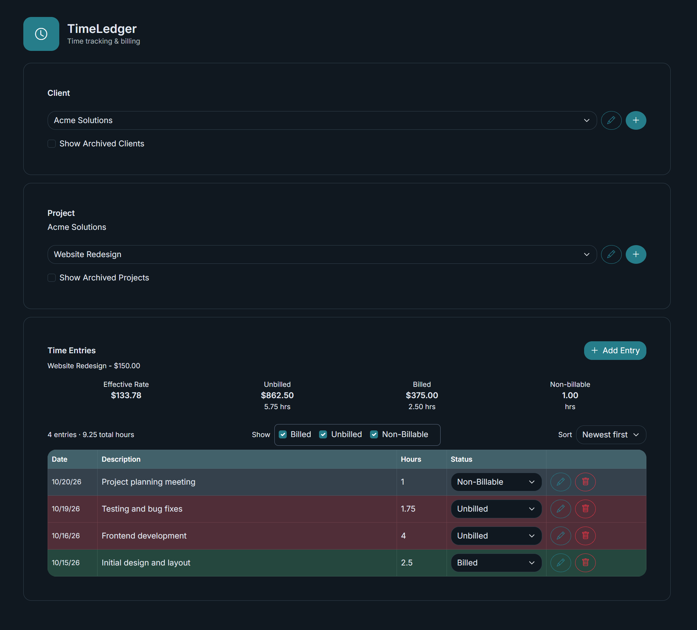
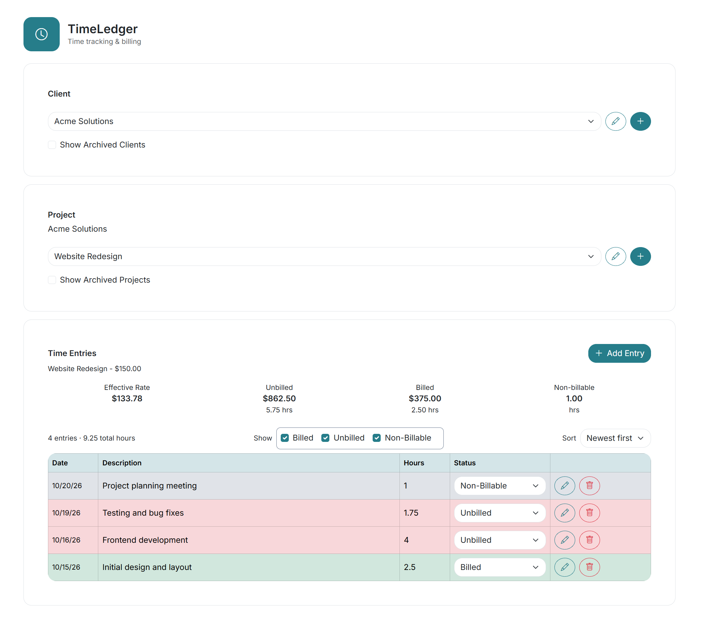
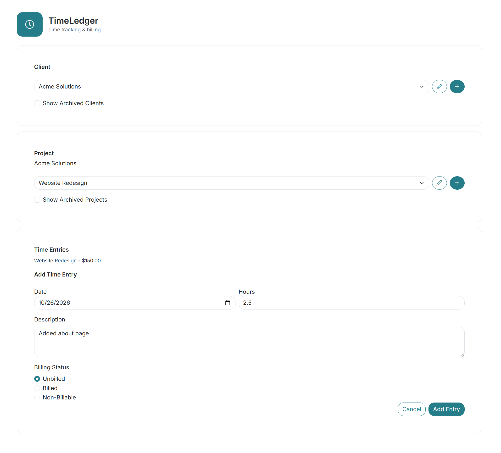
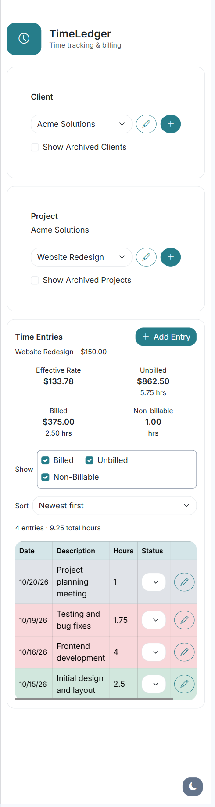

# J++ Timesheet

A project-based timesheet app built with React and TypeScript, with an ASP.NET Core API and SQLite for persistent storage. Organize work by client and project, record hours, and track billed, unbilled, and non-billable time.

Try the frontend with built-in sample data, or run the full stack locally. The application uses the name **TimeLedger** in the browser and backend project.

## Features

- Create and edit clients and projects, including project descriptions and hourly rates.
- Archive clients and projects, with controls to show archived records.
- Add, edit, and delete dated time entries.
- Change billing status directly from the entry table.
- Filter entries by billing status and sort by date or hours.
- View project totals, billed and unbilled amounts, and effective hourly rate.
- Switch between light and dark themes.
- Run in mock mode without a backend or database.

## Quick start: mock demo

Requires Node.js 22.12 or newer and npm. From the repository root:

```sh
cd client
npm ci
```

Copy `client/.env.example` to `client/.env` if you do not already have one. Set:

```dotenv
VITE_USE_MOCKS=true
```

Start the frontend:

```sh
npm run dev
```

Open the local URL printed by Vite, normally `http://localhost:5173`. Select **Acme Solutions**, then **Website Redesign**, to explore the sample entries and billing summary.

Mock data is held in memory. Changes reset when you reload the page. Mock requests include a simulated 500 ms delay.

## Screenshots

**Dark mode**



**Light mode**



**Time entry form**



**Mobile view**



## Stack and structure

| Area | Technology |
| --- | --- |
| Frontend | React 19, TypeScript, Vite |
| Styling | Bootstrap 5, Bootstrap Icons, Sass |
| API | ASP.NET Core on .NET 10 |
| Data | Entity Framework Core, SQLite |

```text
client/
  src/components/             Selectors, time entries, and theme controls
  src/services/               API services and mock implementations
  src/data/                   Sample clients, projects, and entries
  src/types/                  Frontend data models
  src/styles/                 Bootstrap customization
server/TimeLedger.Api/
  TimeLedger.Api/              API controllers, database models, and migrations
```

## Run with the API and database

In addition to the frontend prerequisites, install the .NET 10 SDK and the .NET Entity Framework CLI tool (`dotnet-ef` 10.x). SQLite runs inside the API; no separate database server or Docker installation is required.

### 1. Apply migrations and start the API

From the repository root:

```sh
cd server/TimeLedger.Api/TimeLedger.Api
dotnet restore
dotnet ef database update
dotnet dev-certs https --trust
dotnet run --launch-profile https
```

Certificate trust setup depends on your operating system. The HTTPS profile serves the API at `https://localhost:7076`. The API applies existing migrations at startup, creating an empty database on first run. The explicit database update command above can also be used to apply migrations manually. Add clients, projects, and entries through the app.

The interactive API reference is available at `https://localhost:7076/scalar/v1` while running in Development.

### 2. Start the frontend

In a separate terminal, from the repository root:

```sh
cd client
npm ci
```

Create `client/.env` from `client/.env.example` if needed, and set:

```dotenv
VITE_API_BASE_URL=https://localhost:7076/api
VITE_USE_MOCKS=false
```

```sh
npm run dev
```

Use `http://localhost:5173` for the frontend; the API's development CORS policy allows that origin.

## Database storage

The default connection string in `appsettings.json` is `Data Source=timeledger.db`. Running the commands above creates the database file in the API project directory. Database files and SQLite journal files are excluded from Git.

For a deployed installation, use an absolute path outside the application folder, such as `Data Source=/var/lib/timeledger/timeledger.db`, and set it through the `ConnectionStrings__DefaultConnection` environment variable. The directory must exist and be writable by the API service account. This keeps application updates separate from saved data.

For a simple file backup, stop the API before copying the database and any accompanying SQLite journal files. Data from an existing PostgreSQL database is not transferred automatically.

## Frontend configuration

| Variable | Purpose |
| --- | --- |
| `VITE_USE_MOCKS` | Only the exact string `true` enables sample data. `false` or an omitted value uses the API. |
| `VITE_API_BASE_URL` | API base URL, including `/api`. Used when mocks are disabled. |

Restart the Vite dev server after changing `.env`. Production builds embed these values, so rebuild to change them. Keep secrets out of `VITE_` variables because their values are exposed to the browser.

## Development checks

From `client/`:

```sh
npm run lint
npm run build
```

The build runs TypeScript checks and produces static frontend files in `client/dist/`. Use `npm run preview` to inspect that build locally. An automated test suite has not been added yet.

## Build a downloadable release

Install PowerShell 7+, Node.js 22.12+ with npm, and the .NET 10 SDK. From the repository root:

```powershell
pwsh -File scripts/build-release.ps1 -Version v0.1.0
```

The script installs frontend dependencies, runs lint and the frontend build (including TypeScript checks), publishes a self-contained Linux x64 API, and bundles the React files into its `wwwroot` folder. Output:

```text
artifacts/timeledger-v0.1.0-linux-x64.zip
```

The package uses the real API at `/api` on the same host, regardless of your local mock settings. Your `.env` file is unchanged, and local database files are excluded. No Node.js or .NET runtime installation is needed on the destination; Linux still needs the operating-system libraries required by .NET.

Use `-Runtime linux-arm64` for ARM Linux or `-Runtime win-x64` for a Windows package. The default `linux-x64` target matches the Proxmox installer, which supports Intel/AMD hosts.

### Publish a GitHub release

The workflow in `.github/workflows/release.yml` builds and publishes the Linux ZIP when a version tag is pushed to GitHub. After the code is available at `jeffvpascale/timeledger`, create and push a tag such as `v1.0.0` to that GitHub repository. The workflow uses the same release script, runs lint and build checks, verifies the Linux app starts with an empty SQLite database, and attaches `timeledger-v1.0.0-linux-x64.zip` to the release.

The repository and first release must be publicly accessible before the download commands below will work. Azure DevOps does not run GitHub Actions.

## Install on Proxmox

Run as root in the **Proxmox host shell**:

```sh
curl -fsSL https://raw.githubusercontent.com/jeffvpascale/timeledger/main/proxmox/create-lxc.sh -o /tmp/timeledger-create-lxc.sh && bash /tmp/timeledger-create-lxc.sh
```

Like Local IP Manager, the script offers standard or advanced settings and displays the configuration for confirmation before creating a container. Standard settings use an unprivileged Debian 12 x64 LXC, the next available container ID, 1 CPU core, 1 GB RAM, 512 MB swap, an 8 GB disk, `vmbr0`, DHCP, and start at boot. Advanced settings let you choose storage, networking, resources, Debian 12 or 13, and a specific release.

The script installs the release, configures and starts a systemd service, verifies the web page responds, and prints the address, normally `http://CONTAINER-IP:5000`.

### Install or update an existing LXC

Run as root **inside the Debian 12/13 x64 container**, not on the Proxmox host:

```sh
curl -fsSL https://raw.githubusercontent.com/jeffvpascale/timeledger/main/proxmox/install.sh -o /tmp/timeledger-install.sh && bash /tmp/timeledger-install.sh latest
```

This also works for an existing manual TimeLedger installation using `/opt/timeledger` and `/var/lib/timeledger`. Updates preserve the database. Before replacing the app, the installer snapshots the stopped database and backs up the service configuration. If startup or the HTTP checks fail, it attempts to restore the previous application, database, and service.

To install a local ZIP before publishing to GitHub, copy `proxmox/install.sh` and the ZIP into the container, then run:

```sh
bash /root/install.sh v0.1.0 /root/timeledger.zip
```

The local ZIP command does not download a GitHub release; it still needs internet access for Debian dependencies.

The service starts automatically at boot. Check it with:

```sh
systemctl status timeledger --no-pager -l
journalctl -u timeledger -n 50 --no-pager
```

## Local hosting

Extract the Linux ZIP inside your LXC and make `TimeLedger.Api` executable with `chmod +x TimeLedger.Api`. From the extracted application folder, start it with:

```sh
ConnectionStrings__DefaultConnection="Data Source=/var/lib/timeledger/timeledger.db" ./TimeLedger.Api --urls http://0.0.0.0:5000
```

Create `/var/lib/timeledger` first and give the account running the API write permission. Open `http://CONTAINER-IP:5000` to use the app. The API serves the frontend and initializes the SQLite database without seed data. Production supports local HTTP; development retains HTTPS redirection.

The API currently has no authentication. The project is intended for local development and personal use on a trusted network.

## Scope

This project focuses on manual, project-based time tracking. Timers, invoice generation, retainer calculations, and multi-user authentication are outside its current scope.

## License

TimeLedger is licensed under the [MIT License](LICENSE).
