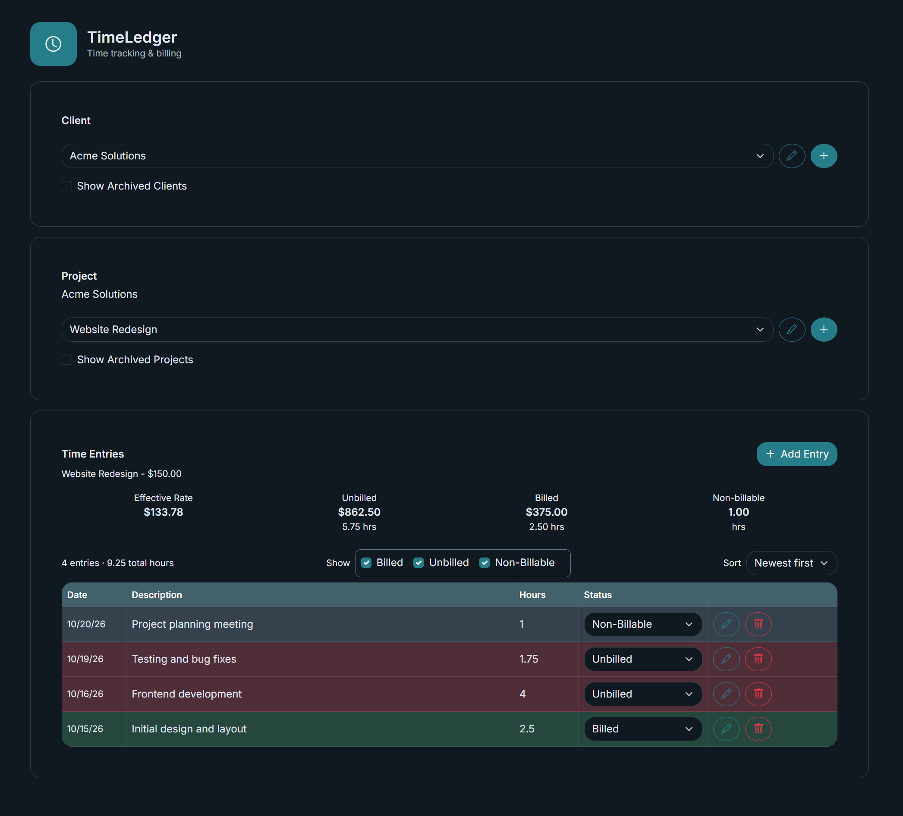
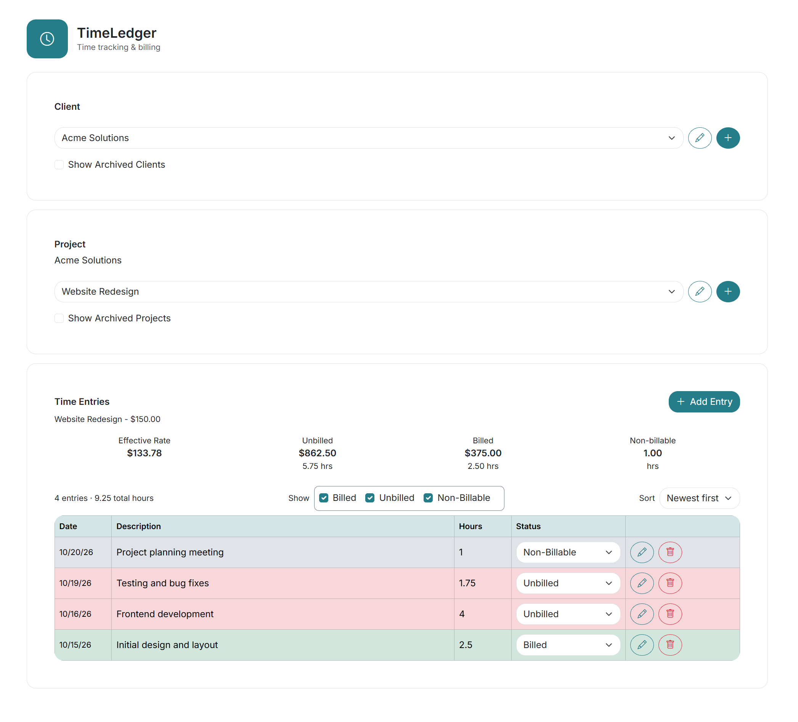
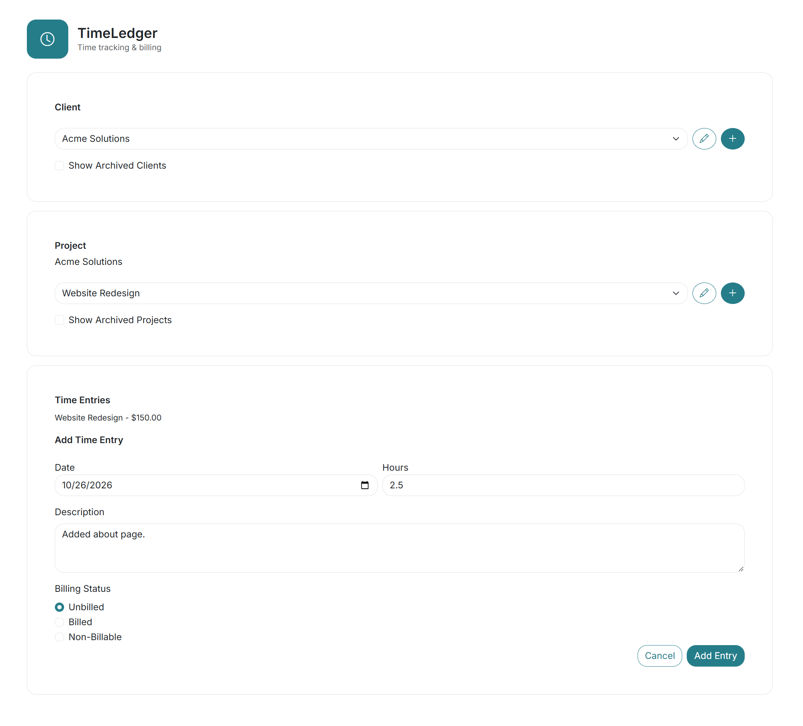
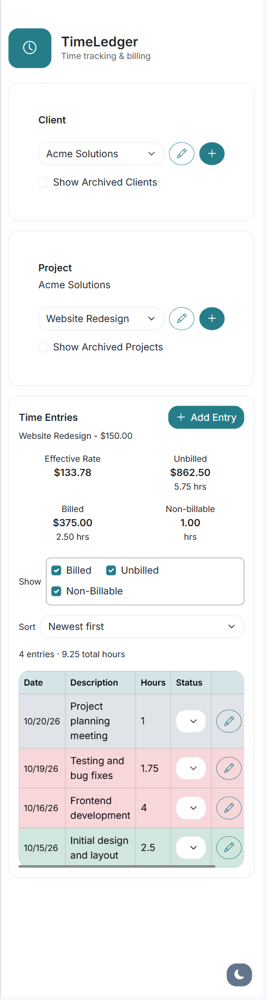

# TimeLedger

TimeLedger is a project-based timesheet application built with React, TypeScript, and ASP.NET Core. Users can register, sign in, manage their own clients and projects, and track billed, unbilled, and non-billable hours.

This branch contains the authenticated cloud version. It supports SQLite locally and SQL Server/Azure SQL through separate launch profiles. The built React frontend and .NET API run together in Azure App Service, with GitHub Actions handling builds and deployment.

GitHub Pages and Proxmox deployment are maintained separately from this version.

## Features

- Register, sign in, remember a session, and sign out.
- Update account details and change passwords.
- Protect API endpoints and restrict clients, projects, and time entries to their owner.
- Create and edit clients and projects, including descriptions and hourly rates.
- Archive clients and projects, with controls to show archived records.
- Add, edit, and delete dated time entries.
- Change billing status directly from the entry table.
- Filter entries by billing status and sort by date or hours.
- View project totals, billed and unbilled amounts, and effective hourly rate.
- Switch between light and dark themes.
- Restore the last selected client and project and remember display preferences in browser local storage.

## Stack and structure

| Area | Technology |
| --- | --- |
| Frontend | React 19, TypeScript, Vite |
| Styling | Bootstrap 5, Bootstrap Icons, Sass |
| API | ASP.NET Core on .NET 10 |
| Authentication | ASP.NET Core Identity with cookie authentication |
| Data | Entity Framework Core, SQLite, SQL Server/Azure SQL |
| Hosting | Azure App Service on Windows |
| Deployment | GitHub Actions with OpenID Connect (OIDC) |

```text
client/
  src/components/             Selectors, time entries, and shared controls
  src/context/                Authentication state
  src/pages/                  Login, registration, account, and timesheet pages
  src/services/               API services, mock data services, and preferences
  src/styles/                 Bootstrap customization
  src/types/                  Frontend data models
server/TimeLedger.Api/
  TimeLedger.Api/              Controllers, entities, context, and SQLite migrations
  TimeLedger.Migrations.SqlServer/
                              Separate SQL Server migrations
.github/workflows/            Azure build and deployment workflow
```

## Run locally with SQLite

Requires Node.js 22.12 or newer, npm, and the .NET 10 SDK. Visual Studio with .NET web development support is optional.

### 1. Start the API

From the repository root:

```powershell
cd server/TimeLedger.Api/TimeLedger.Api
dotnet restore
dotnet dev-certs https --trust
dotnet run --launch-profile https-sqlite
```

Certificate trust setup depends on your operating system. The API listens at `https://localhost:7076`. The SQLite profile applies its migrations at startup and creates an empty database on first run.

In Visual Studio, open `server/TimeLedger.Api/TimeLedger.Api.slnx`, set `TimeLedger.Api` as the startup project, and select the `https-sqlite` launch profile.

The interactive API reference is available at `https://localhost:7076/scalar/v1` in Development.

### 2. Start React

In a separate terminal, from the repository root:

```powershell
cd client
npm ci
Copy-Item .env.example .env
```

If `.env` already exists, edit it instead of overwriting it. Use:

```dotenv
VITE_API_BASE_URL=https://localhost:7076/api
VITE_USE_MOCKS=false
```

Then run:

```powershell
npm run dev
```

Open `http://localhost:5173`, register an account, and sign in. Passwords require at least eight characters with an uppercase letter, lowercase letter, digit, and special character.

The development CORS policy allows `http://localhost:5173`. Use the HTTPS API profile because authentication cookies require secure transport.

## Database profiles and storage

| Launch profile | Provider | Connection string name |
| --- | --- | --- |
| `https-sqlite` | SQLite | `DefaultConnection` |
| `https-sqlserver` | SQL Server/Azure SQL | `SqlServer` |

Both profiles use the Development environment and the same local ports. The `DatabaseProvider` setting selects the provider independently of the Debug/Release build configuration. `SqlServer` selects SQL Server; when omitted, the current default is SQLite.

SQLite uses `Data Source=timeledger.db` from `appsettings.json`. Running the API from its project directory stores the database there. Database files and journal files are excluded from Git.

SQLite and Azure SQL are separate databases: accounts and timesheet data are not copied between them automatically. Local testing against Azure SQL modifies whichever database the connection string names. The current deployment shares its Azure development database between local SQL Server testing and the hosted app.

### Connect locally to Azure SQL

The Azure SQL server must have a Microsoft Entra administrator configured, and its firewall must allow your computer's public IP address. Install Azure CLI and sign in to the appropriate subscription:

```powershell
az login
```

From the API project directory, store the connection in .NET User Secrets. The project already has a `UserSecretsId`:

```powershell
dotnet user-secrets set "ConnectionStrings:SqlServer" "Server=tcp:<server-name>.database.windows.net,1433;Database=<database-name>;Authentication=Active Directory Default;Encrypt=True;TrustServerCertificate=False;Connection Timeout=60;"
```

Replace the placeholders with your server and database names. The connection can use your Azure CLI sign-in without a database password. Restart Visual Studio after installing Azure CLI so it can find the updated PATH.

Select `https-sqlserver` in Visual Studio, or run:

```powershell
dotnet run --launch-profile https-sqlserver
```

Apply SQL Server migrations before starting the app against a new database. They are not applied automatically at startup.

### Migrations

SQLite migrations live in the API project. SQL Server migrations live in `TimeLedger.Migrations.SqlServer`, which references the API and writes its build output beside the API. Build the solution when working with migrations.

The examples below run in Visual Studio's Package Manager Console with `TimeLedger.Api` as the startup project.

After changing the model, generate a migration for each provider:

```powershell
Add-Migration <ChangeName> -Project TimeLedger.Api -StartupProject TimeLedger.Api -Context TimeLedgerDbContext -Args '--DatabaseProvider Sqlite --environment Development'

Add-Migration <ChangeName> -Project TimeLedger.Migrations.SqlServer -StartupProject TimeLedger.Api -Context TimeLedgerDbContext -Args '--DatabaseProvider SqlServer --environment Development'
```

Review the generated migration files before applying them. Apply SQL Server migrations explicitly:

```powershell
Update-Database -Project TimeLedger.Migrations.SqlServer -StartupProject TimeLedger.Api -Context TimeLedgerDbContext -Args '--DatabaseProvider SqlServer --environment Development'
```

This updates the database named by your local `SqlServer` connection string. SQLite migrations are applied on startup when that provider is selected. The GitHub deployment workflow does not apply database migrations.

## Configuration

### Frontend

| Variable | Purpose |
| --- | --- |
| `VITE_USE_MOCKS` | Only the exact string `true` enables mock timesheet services. Use `false` for the authenticated application. |
| `VITE_API_BASE_URL` | API base URL including `/api`. Use `https://localhost:7076/api` with Vite, or `/api` for bundled hosting. |
| `VITE_DEFAULT_HOURLY_RATE` | Initial rate for new projects. Defaults to `100` when omitted, blank, invalid, or negative; `0` is allowed. Existing rates are unchanged. |

Restart Vite after changing `.env`. Production builds embed these settings, so changing them requires rebuilding React. Keep secrets out of `VITE_` values because they are exposed to the browser.

Mock services remain in the codebase, but authentication still uses the API. Mock mode is not a standalone frontend-only login demo.

View preferences are stored in browser local storage, separately for mock and API modes, and are not scoped per account. Client, project, and time-entry records are stored in the selected database. Clearing browser storage resets display preferences without deleting database records.

### API

| Setting | Purpose |
| --- | --- |
| `DatabaseProvider` | Set to `SqlServer` for Azure SQL or `Sqlite` for local SQLite. |
| `ConnectionStrings:DefaultConnection` | SQLite connection string. |
| `ConnectionStrings:SqlServer` | SQL Server/Azure SQL connection string. |
| `ASPNETCORE_ENVIRONMENT` | `Development` locally; `Production` in Azure. Launch profiles are local settings and are not deployed. |

Use User Secrets locally and App Service environment variables in Azure. A double underscore represents a configuration separator in environment variable names, for example `ConnectionStrings__SqlServer`.

## Build and test bundled hosting locally

From `client/` in PowerShell:

```powershell
$env:VITE_USE_MOCKS = "false"
$env:VITE_API_BASE_URL = "/api"
npm ci
npm run lint
npm run build
Remove-Item Env:VITE_USE_MOCKS
Remove-Item Env:VITE_API_BASE_URL

New-Item -ItemType Directory -Force -Path "../server/TimeLedger.Api/TimeLedger.Api/wwwroot"
Copy-Item -Path "./dist/*" -Destination "../server/TimeLedger.Api/TimeLedger.Api/wwwroot" -Recurse -Force
```

These commands temporarily override the frontend settings for this build without editing `.env`. Stop Vite and start the API with either HTTPS profile. Open `https://localhost:7076` to test React and the API on the same host.

ASP.NET serves the built frontend from `wwwroot`. A fallback serves `index.html` for React routes such as `/login`, `/account`, and `/time-ledger`, allowing direct links and page refreshes.

Generated `dist` and `wwwroot` files are excluded from Git. An automated test suite has not been added yet; the current workflow runs lint, TypeScript/build checks, and .NET publishing.

## Azure hosting

The current deployment uses Windows Azure App Service with the .NET 10 runtime and an Azure SQL database. React and the API share one HTTPS host.

The app's system-assigned managed identity is enabled and has a database user with `db_datareader` and `db_datawriter` roles. Schema updates are applied separately by a developer with migration permissions. The SQL firewall allows the app's outbound IP addresses.

App Service application settings:

```dotenv
ASPNETCORE_ENVIRONMENT=Production
DatabaseProvider=SqlServer
ConnectionStrings__SqlServer=Server=tcp:<server-name>.database.windows.net,1433;Database=<database-name>;Authentication=Active Directory Managed Identity;Encrypt=True;TrustServerCertificate=False;Connection Timeout=60;
```

Enable HTTPS Only in App Service. The managed identity connection has no database password. Deleting and recreating the app creates a new system-assigned identity, requiring database access to be granted again.

A first request after inactivity can take longer while the hosting app starts or the serverless database resumes. The current deployment uses the Free F1 App Service plan and the Azure SQL free offer with overage billing disabled. Check the actual resource tiers and subscription costs in Azure; free service limits and subscription credit are separate.

### CI/CD

The workflow in `.github/workflows/deploy-azure.yml` deploys pushes to `azure`. Pushes that change only Markdown files or files under `docs/` are skipped. Manual runs are available through GitHub Actions.

The workflow:

1. Installs frontend dependencies with `npm ci`.
2. Runs ESLint and builds React with mocks disabled and `/api` as the API URL.
3. Copies the frontend build into the API's `wwwroot`.
4. Publishes the API in Release configuration.
5. Transfers the published artifact to the deployment job.
6. Signs in to Azure using OIDC and deploys to the existing App Service production slot.

GitHub Actions uses a separate user-assigned deployment identity with permission to deploy to the web app. It is distinct from the app's system-assigned identity used for database access. Azure-generated GitHub repository secrets supply the client, tenant, and subscription identifiers; no deployment password is stored in the workflow.

Database migrations remain a separate, explicit step. For schema changes, review and apply the appropriate migration before deploying code that requires it.

## Screenshots

**Dark mode**



**Light mode**



**Time entry form**



**Mobile view**



## Scope and future work

TimeLedger focuses on manual, project-based time tracking. This branch demonstrates authentication, per-user data access, multiple EF Core providers, managed identity, and automated cloud deployment.

Potential future enhancements include password recovery by email, automated tests, invoice generation, and additional reporting. Password recovery and email verification are not implemented.

## License

TimeLedger is licensed under the [MIT License](LICENSE).
